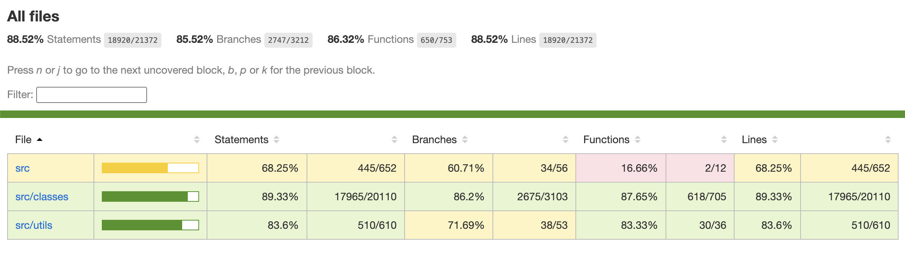
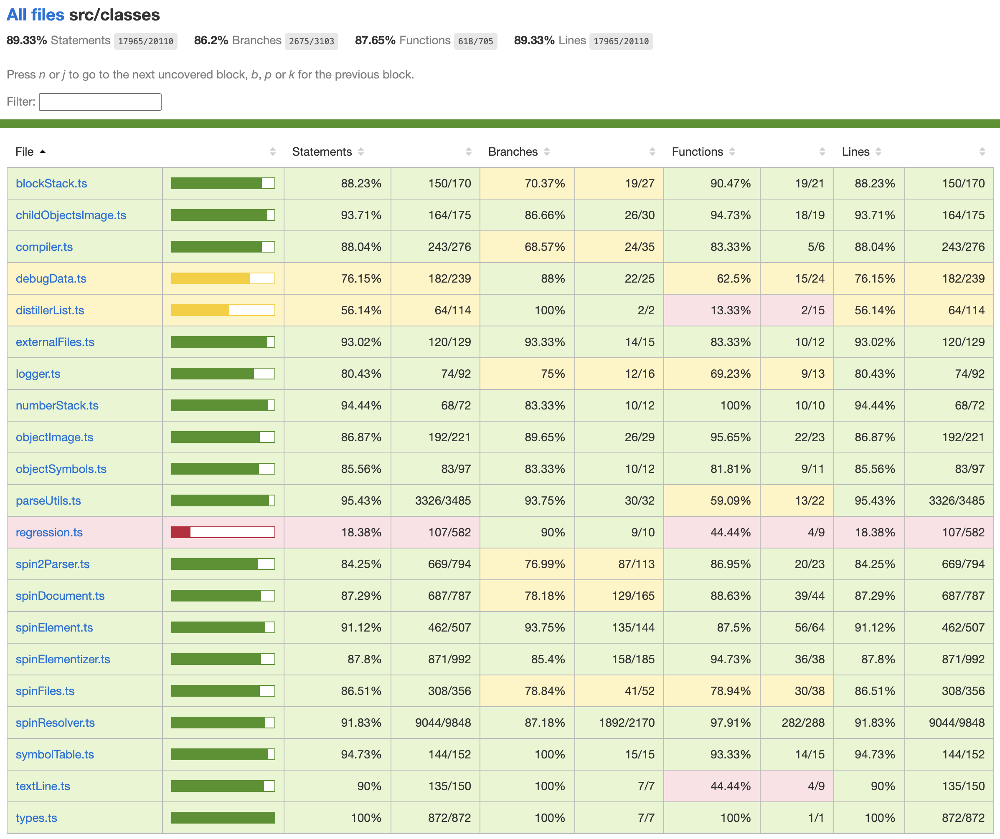

# PNut-TS - Coverage Testing

![Project Maintenance][maintenance-shield]

[![License][license-shield]](LICENSE)

![NodeJS][node-badge]

[![Release][Release-shield]](https://github.com/ironsheep/PNut-TS/releases)

[![GitHub issues][Issues-shield]](https://github.com/ironsheep/PNut-TS/issues)

## Running coverage

One command measures which compiler lines the regression suite executes:

```bash
npm run coverage
```

It builds the compiler, runs every test root the regression suite gates on, and writes its report to `PROCESS/coverage/Regression-Coverage-Baseline.md`. It takes about 25 minutes. It needs no special setup, it changes no tracked files, and you can commit normally afterwards.

To also check every unexecuted line against the review list:

```bash
npm run coverage -- --check
```

| Exit code | Meaning |
| --- | --- |
| 0 | Clean. Every unexecuted compiler line is on the review list. |
| 1 | At least one unexecuted line is not on the review list. |
| 2 | Not evaluable. The review list is absent. |
| 3 | Hard error: a failing test, a changed build, or an unreadable dump. |

The review list, `PROCESS/coverage/classified.json`, is kept by the maintainers and is not in the repository. On a fresh clone `--check` therefore exits 2, which is expected and not a failure.

Maintainers run this at each PNut-parity release and when hunting thin spots. It does not block a release. See [the release process](DOCs/RELEASE-PROCESS.md).

For a summary of the regression suite by test category, see the [Regression Test Coverage Report](DOCs/Regression-Test-Coverage-Report.md).

## Earlier coverage reports

The reports below are kept as history. They came from a coverage tool we have since retired, so they do not describe the current compiler or test suite.

### v1.52.x

This is our coverage status at the v1.52.0 release. Since the last release we've increased coverage of PASM instructions and constants in the compiler.

<br>**FIGURE 1.52-1**: v1.52.1 `top-level` coverage report view.

<br>**FIGURE 1.52-2**: v1.52.1 `src/classes` coverage report view.

### v1.51.x

This is our coverage status at the v1.51.0 release. In this release coverage effort we focused on the most important areas which would yield the best certification of the compiler in general. We didn't test many of the more extreme (infrequently exercised) cases. We did try to cover all regions that affect actual code generation.

<br>**FIGURE 1.50-1**: v1.51.0 `top-level` coverage report view.

<br>**FIGURE 1.50-2**: v1.51.0 `src/classes` coverage report view.

### v1.43.x

This is our coverage status at the v1.43.0 testing release. In this first coverage effort we focused on the most important areas which would yield the best certification of the compiler in general. We didn't test many of the more extreme (infrequently exercised) cases. We did try to cover all regions that affect actual code generation.

<br>**FIGURE 1.43-1**: v1.43.0 `top-level` coverage report view.

<br>**FIGURE 1.43-2**: v1.43.0 `src/classes` coverage report view.

---

> If you like my work and/or this has helped you in some way then feel free to help me out for a couple of :coffee:'s or :pizza: slices or support my work by contributing at Patreon!
>
> [](https://www.buymeacoffee.com/ironsheep) &nbsp;&nbsp; -OR- &nbsp;&nbsp; [](https://www.patreon.com/IronSheep?fan_landing=true)[Patreon.com/IronSheep](https://www.patreon.com/IronSheep?fan_landing=true)

---

## License

Licensed under the MIT License.

Follow these links for more information:

### [Copyright](copyright) | [License](LICENSE)

[maintenance-shield]: https://img.shields.io/badge/maintainer-stephen%40ironsheep%2ebiz-blue.svg?style=for-the-badge

[license-shield]: https://img.shields.io/badge/License-MIT-yellow.svg

[Release-shield]: https://img.shields.io/github/release/ironsheep/PNut-TS/all.svg

[Issues-shield]: https://img.shields.io/github/issues/ironsheep/PNut-TS.svg

[node-badge]: https://img.shields.io/badge/node.js-6DA55F?style=for-the-badge&logo=node.js&logoColor=white
